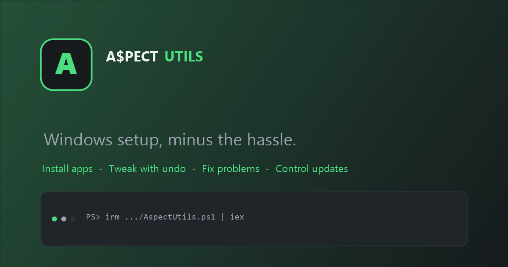

# A$PECT UTILS

A$PECT UTILS is a Windows 11 setup utility for installing apps, applying reversible tweaks, running common fixes, and controlling Windows Update. It ships as a PowerShell app and as a native WPF desktop app, and both front ends read the same configuration files in `config/`.

A$PECT UTILS is a rebranded fork of [WinUtil](https://github.com/ChrisTitusTech/winutil) by Chris Titus Tech and contributors, used under the MIT license. See [NOTICE.md](NOTICE.md).



## Quick start

### Desktop app

Download the latest self-contained build from the [Releases page](https://github.com/flickfpz/AspectUtils/releases/latest) (`AspectUtils-Desktop.zip`), or build it from source with the .NET 8 SDK:

```powershell
dotnet build desktop\AspectUtils.Desktop.csproj -c Release
.\desktop\bin\Release\net8.0-windows\AspectUtils.exe
```

To produce a self-contained build you can copy to another PC:

```powershell
dotnet publish desktop\AspectUtils.Desktop.csproj -c Release -r win-x64 --self-contained true -p:PublishSingleFile=true -o artifacts\desktop
```

The app requests administrator rights when it starts. See [desktop/README.md](desktop/README.md) for details.

### PowerShell

Run PowerShell or Terminal as Administrator, then:

```powershell
irm "https://github.com/Fl1ckfps/AspectUtils/releases/latest/download/AspectUtils.ps1" | iex
```

To run from a local checkout instead:

```powershell
.\Compile.ps1 -Run
```

### Presets

Apply a predefined configuration without manual selection:

```powershell
& ([ScriptBlock]::Create((irm "https://github.com/Fl1ckfps/AspectUtils/releases/latest/download/AspectUtils.ps1"))) -Preset Standard
```

| Preset | Description |
|--------|-------------|
| `Standard` | Balanced defaults for most users |
| `Minimal` | Minimal changes to suit every user |
| `Advanced` | Deep tweaks for power users |

The exact contents are defined in [`config/preset.json`](config/preset.json).

## What's included

- **Install apps** through WinGet and Chocolatey, including upgrade and uninstall flows.
- **Tweaks with undo**: reversible registry and service changes, plus one-time cleanup actions.
- **Windows features** such as Hyper-V, WSL, .NET, Sandbox, and legacy panels.
- **Fixes** for networking, NTP, system repair, WinGet, and Windows Update.
- **Windows Update profiles**: default, recommended, and disabled, with a restore path.
- **Activation tab** for Windows and Office via Microsoft Activation Scripts (MAS).
- **Own branding and documentation** with a mint and gray theme.

The desktop app covers installs, tweaks and undo, fixes, features, and update profiles. AppX package management and Win11 Creator are currently available only in the PowerShell app.

## Build and develop

The PowerShell app compiles from the source files in `scripts/`, `functions/`, and `xaml/`:

```powershell
.\Compile.ps1
```

The compiled `AspectUtils.ps1` is generated output and is not committed.

Desktop app:

```powershell
dotnet build desktop\AspectUtils.Desktop.csproj -c Debug
```

Tests:

```powershell
Import-Module Pester -RequiredVersion 5.8.0 -Force
Invoke-Pester -Path 'pester/*.Tests.ps1' -Output Detailed -CI
```

Script Analyzer:

```powershell
Invoke-ScriptAnalyzer -Path . -Settings .\lint\PSScriptAnalyser.ps1 -Recurse
```

## Repository layout

| Path | Purpose |
|------|---------|
| `AspectUtils.ps1` | Compiled PowerShell app (generated, gitignored) |
| `Compile.ps1` | Builds `AspectUtils.ps1` from the source files |
| `scripts/`, `functions/`, `xaml/` | PowerShell app source |
| `config/` | Shared JSON catalogs for apps, tweaks, features, and presets |
| `desktop/` | Native .NET 8 WPF desktop app |
| `docs/` | Astro/Starlight documentation site |
| `tools/branding/` | Generates the logo, social preview, and app icon |

## Documentation

- [Documentation site source](docs/)
- [Desktop app notes](desktop/README.md)
- [Contributing guide](docs/src/content/docs/contributing.mdx)

## License

MIT. The original WinUtil copyright notice is preserved in [LICENSE](LICENSE). See [NOTICE.md](NOTICE.md) for attribution and a summary of changes.
