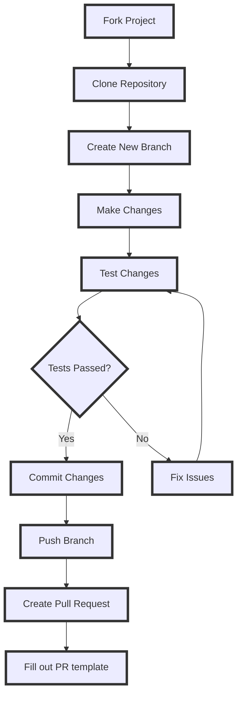

## Testing

* Test the latest changes to A$PECT UTILS by running a pre-release and reporting any issues you encounter.

#### Run the latest pre-release

Download the newest pre-release from [GitHub Releases](https://github.com/AspectCorp/AspectUtils/releases), then run the downloaded script from an elevated PowerShell session:

```ps1
.\AspectUtils.ps1
```

:::caution
Pre-release builds contain changes that have not reached a stable release. Use them for testing only, not in production.
:::

## Issues

* If you encounter any problems, submit them via the [Issues](https://github.com/AspectCorp/AspectUtils/issues) tab on the GitHub repository. Filling out the provided template with specific details helps maintainers and contributors address bugs and consider feature requests.

## Contribute Code

* Pull requests are now handled directly on the **MAIN branch**. This was done since we can now select specific releases to launch via releases in GitHub.

* If you're doing code changes, then you can submit a PR to the `main` branch.

:::caution
Do not use a code formatter, make massive amounts of line changes, or make multiple feature changes. EACH FEATURE CHANGE SHOULD BE ITS OWN PULL REQUEST!
:::

:::caution
Do not open a pull request that adds support for other languages for now, until the project decides how to handle language support.
:::

* When creating pull requests, it is essential to thoroughly document all changes made. This includes, but is not limited to, documenting any additions made to the `tweaks` section and corresponding `undo tweak`, so users are able to remove the newly added tweaks if necessary, and comprehensive documentation is required for all code changes. Document your changes and briefly explain why you made your changes in your Pull Request Description. Failure to adhere to this format may result in the denial of the pull request. Additionally, any code lacking sufficient documentation may also be denied.

* By following these guidelines, we can maintain a high standard of quality and ensure that the codebase remains organized and well-documented.

:::note
When creating a function, please include "WPF" or "WinUtil" in the file name so it can be loaded into the runspace.
:::

## Walk through

* This is a guide for beginners. If you are still having issues, look at the following official GitHub documentation:
    * [Commit through WEB](https://docs.github.com/en/pull-requests/committing-changes-to-your-project/creating-and-editing-commits/about-commits)
    * [Commit through GitHub Desktop](https://docs.github.com/en/desktop/making-changes-in-a-branch/committing-and-reviewing-changes-to-your-project-in-github-desktop#about-commits)
    * [Create a Pull Request](https://docs.github.com/en/pull-requests/collaborating-with-pull-requests/proposing-changes-to-your-work-with-pull-requests/creating-a-pull-request)


### Overview



:::note
This is a diagram to guide you through the process. It may vary depending on the type of change you're making.
:::

### Fork the Repo
* Fork the A$PECT UTILS repository [here](https://github.com/AspectCorp/AspectUtils) to create a copy that will be available in your repository list.


### Clone the Fork
:::tip
While you can make your changes directly through the web, we recommend cloning the repo to your device using GitHub Desktop (available from the Install tab) to test your fork easily.
:::

* Install GitHub Desktop if it is not already installed.
* Log in using the same GitHub account you used to fork A$PECT UTILS.
* Choose the fork under "Your Repositories" and press "clone `{repo name}`"
* Create a new branch and name it something relatable to your changes.

* Now you can modify A$PECT UTILS to your liking using your preferred text editor.


### Testing your changes

* To test to see if your changes work as intended, run the following commands in a PowerShell terminal as admin:

* Change the directory where you are running the commands to the forked project root.
* Run the following command to compile and run the PowerShell app:
* `.\PowerShellApp\Compile.ps1 -Run`

* To build the desktop app:
* `dotnet build MainApp/AspectUtils.Desktop.csproj -c Debug`

* To build the installer (requires Inno Setup 6):
* `.\Installer\build.ps1`


* After seeing that your changes work properly, feel free to commit the changes to the repository and make a PR. For help on that, follow the documentation below.

### Committing the changes
* Before committing your changes, please discard changes made to the generated `PowerShellApp/AspectUtils.ps1` file, like the following:


* Now, commit your changes once you are happy with the result.


* Push the changes to upload them to your fork on GitHub.


### Making a PR
* To make a PR on your repo under a new branch linking to the main branch, a button will show and say Preview and Create pull request. Click that button and fill in all the information that is provided on the template. Once all the information is filled in correctly, check your PR to make sure there is no AspectUtils.ps1 file attached to the PR. Once everything is good, make the PR and wait for a maintainer to review it.
* Approved changes can be published as a pre-release before they reach the stable release, so they can be tested before going fully public.
* Congratulations! You just submitted your first PR. Thank you for contributing to A$PECT UTILS.
